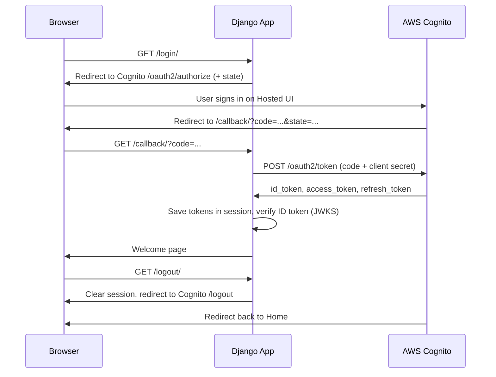

# Cognito Login in a Django App

**Subject:** iMAD (Introduction to Mobile App Development), Group Project
**Topic 1:** A Django app where users log in and log out through an AWS Cognito User Pool (Hosted UI) and land on a welcome page.

---

## Team Members & Roles

| Member | Role | What they built |
|---|---|---|
| **Rhythem Kalra** | Repo owner & AWS setup | GitHub repo, Django project skeleton, settings + `.env` handling, `.gitignore`, base layout + home page, Cognito User Pool + App Client + Hosted UI setup |
| **Bhoomi** | Login flow | `/login/` (redirect to Hosted UI with `state`) and `/callback/` (state check + code-for-token exchange) in `accounts/views_login.py` |
| **Krati** | Token verification & Welcome page | `accounts/jwt_utils.py` (verifies JWT signature via JWKS, expiry, issuer, audience), `/welcome/` view and `welcome.html`, plus the **JWT tamper test** page (`views_tamper.py`) |
| **Kanishka** | Logout & Documentation | `/logout/` (clears session + Cognito logout) in `accounts/views_logout.py`, README, architecture diagram, flowchart, screenshots |

---

## What the app does

1. **Home page** (`/`) shows a **Login with Cognito** button.
2. **Login** (`/login/`) sends the user to the **Cognito Hosted UI**, a login page hosted by AWS. Our app never sees the password.
3. After login, Cognito redirects back to **`/callback/`** with a one-time **code**. Django exchanges that code for **tokens** (JWTs).
4. **Welcome page** (`/welcome/`) verifies the ID token and shows the user's name, email and the token's contents.
5. **Tamper test** (`/tamper-test/`) breaks the real token in four ways and shows that every fake version is rejected.
6. **Logout** (`/logout/`) clears the Django session and logs the user out of Cognito too.

---

## Architecture




### Flowchart


### Project structure

```
cognito-django-login/
├── config/              # Django project settings & root URLs
│   ├── settings.py      # reads Cognito values from .env
│   └── urls.py
├── accounts/            # our app
│   ├── urls.py          # /, /login/, /callback/, /welcome/, /logout/
│   ├── views_home.py    # Home page             (Rhythem)
│   ├── views_login.py   # Login + callback      (Bhoomi)
│   ├── jwt_utils.py     # JWT verification      (Krati)
│   ├── views_welcome.py # Welcome page          (Krati)
│   ├── views_tamper.py  # JWT tamper test       (Krati)
│   └── views_logout.py  # Logout                (Kanishka)
├── templates/           # base.html, home.html, welcome.html
├── docs/                # diagrams + screenshots
├── .env.example         # template for secrets (real .env is NOT committed)
├── .gitignore
└── requirements.txt
```

---

## Setup Steps

### 1. AWS Cognito (done once by one person, free tier)

1. Log in to the **AWS Console** and set the region (top right) to **Asia Pacific (Mumbai) ap-south-1**.
2. Search **Cognito** → **Create user pool**.
3. Application type: **Traditional web application**. Name it `django-cognito-app`.
4. Sign-in identifiers: **Email**. Required attributes for sign-up: **email** (optionally **name**).
5. **Return URL:** `http://localhost:8000/callback/` → **Create**.
6. Open the new pool → **App clients** → your app client → **Login pages** → **Edit**:
   - Allowed callback URLs: `http://localhost:8000/callback/`
   - Allowed sign-out URLs: `http://localhost:8000/`
   - OAuth grant type: **Authorization code grant**
   - Scopes: **openid**, **email**, **profile** → **Save**.
7. Note down these values:
   - **User pool ID** (pool overview page, e.g. `ap-south-1_AbC123`)
   - **Client ID** and **Client secret** (App client page)
   - **Domain** (left menu → **Domain**, e.g. `ap-south-1abc123.auth.ap-south-1.amazoncognito.com`)

### 2. Run the app locally

```bash
git clone https://github.com/<owner>/cognito-django-login.git
cd cognito-django-login
python -m venv venv
source venv/bin/activate          # Windows: venv\Scripts\activate
pip install -r requirements.txt
cp .env.example .env              # Windows: copy .env.example .env
# open .env and paste the Cognito values from step 1
python manage.py migrate          # creates the session table
python manage.py runserver
```

Open **http://localhost:8000** (use `localhost`, not `127.0.0.1`, because it must match the callback URL).

---

## Screenshots

| Home | Cognito Hosted UI |
|---|---|
|  |  |

| Welcome (after login) | After logout |
|---|---|
|  |  |

---

## Research Questions (in our own words)

### Q1. What are a user pool and an app client? (Rhythem)

A **user pool** is a user directory that AWS Cognito manages for us. It stores every user who signs up (email, password, verified status, attributes like name) and handles sign-up, sign-in, password reset and email verification. Because of this, our Django app does not need its own users table or password storage.

An **app client** is how a specific application gets permission to use the user pool. One user pool can have many app clients, for example a web app and a mobile app. Each app client has its own **Client ID** (and optionally a **Client Secret**), its allowed callback and sign-out URLs, the OAuth flows it may use, and the scopes it may request. Our Django app is one app client. When it sends a user to the Hosted UI, Cognito checks the client ID and only redirects back to the URLs we whitelisted.

### Q2. What is a JWT and what does it contain? (Krati)

A **JWT (JSON Web Token)** is a compact, signed piece of text that proves who someone is. It has three parts separated by dots: `header.payload.signature`. Each part is Base64URL-encoded.

- **Header:** the algorithm used to sign it (`RS256`) and the key ID (`kid`) that tells us which of Cognito's public keys to use.
- **Payload (claims):** the actual information, for example:
  - `sub` (the user's unique ID)
  - `email`, `email_verified`, `name`
  - `iss` (issuer, our user pool's URL)
  - `aud` (audience, our app client ID)
  - `token_use` (`id` or `access`)
  - `iat` (issued at) and `exp` (expiry time)
- **Signature:** created by Cognito with its **private key**. We check it with Cognito's **public key**, downloaded from the JWKS URL. If anyone changes even one character of the payload, the signature check fails.

The payload is only encoded, not encrypted, so anyone can read it. That is why we must **verify** the signature, expiry, issuer and audience before trusting it. Cognito gives three tokens:
- **ID token:** who the user is.
- **Access token:** what the user is allowed to access.
- **Refresh token:** used to get new tokens later without logging in again.

### Q3. How does the OAuth 2.0 redirect login flow work, step by step? (Bhoomi)

OAuth 2.0 is a standard way of letting another service do the login for you. This is exactly what happens in our app:

1. The user clicks Login. Our app sends them to Cognito's login page, along with our client ID, the address to send them back to, the details we want (openid, email, profile) and a random 'state' value that we also save in the session.
2. The user types their email and password on Cognito's page, so the password never reaches our server.
3. Cognito sends the user back to our /callback/ page with a one-time code and the same state value.
4. We check that the state matches the one we saved. If it doesn't, the response could be fake, so we stop there.
5. Our server sends the code together with our client secret to Cognito, and Cognito replies with the ID, access and refresh tokens.
6. We check the ID token and show the welcome page.

We receive a code first instead of the tokens directly because the code passes through the browser, where someone could see it. On its own the code is useless, since it only works together with the client secret, and only our server knows that.

---

## JWT Tamper Test

From the Welcome page, click **Run tamper test**. The app takes the real ID token and runs five versions through the same verification:

| Test | What we changed | Result |
|---|---|---|
| Original token | nothing | ✅ Accepted |
| Payload edited | email changed to `hacker@evil.com`, old signature kept | ❌ `InvalidSignatureError` |
| Signature edited | one letter of the signature changed | ❌ `InvalidSignatureError` |
| Expired token | checked as if its expiry time had passed | ❌ `ExpiredSignatureError` |
| Token for another app | checked against a different client ID | ❌ `InvalidAudienceError` |

This proves that reading a JWT is not enough: anyone can edit the payload, but without Cognito's private key they cannot make a matching signature.


---

## Security notes

- Secrets live in `.env`, which is listed in `.gitignore` and never committed. `.env.example` shows the format only.
- The `state` parameter prevents CSRF on the callback.
- Tokens are stored in the server-side session, not in browser localStorage.
- The ID token is verified with Cognito's public keys, which are **cached** so we don't call AWS on every request.
- Only AWS free tier is used (Cognito Lite tier is free for up to 10,000 monthly active users).
